<p align="center">
  
</p>

<p align="center">
  <b>Браузер на базе <a href="https://github.com/LadybirdBrowser/ladybird">Ladybird</a>, созданный специально для Steam Deck (SteamOS) и Linux-портативок.</b>
</p>

<p align="center">
  Разработан специально для сообщества <b>Decky Loader Россия</b> (<a href="https://deckyloader.ru">deckyloader.ru</a>).
</p>

---

## Основные возможности

- 🎮 **Полная поддержка SteamOS Game Mode и Desktop Mode**: чёткий рендеринг 1:1 без мыла в Gamescope с автоматическим определением нативного разрешения экрана (1280×800 на Steam Deck, 1080p/4K на внешних мониторах и ТВ).
- 🕹️ **Управление с геймпада и трекпадов**: полноценная навигация без клавиатуры и мыши — правый стик управляет курсором, левый стик и трекпад отвечают за прокрутку, триггеры `R2`/`L2` за клики, `L1`/`R1` переключают вкладки, `B`/`X`/`Y` управляют историей и обновлением страниц.
- 🧩 **Прямая интеграция с [deckyloader.ru](https://deckyloader.ru)**: установка, обновление и удаление плагинов Decky Loader прямо со страницы сайта в один клик.
- 📥 **Встроенный торрент-клиент**: управление загрузками прямо в браузере с фоновым сервисом и плагином для Decky Loader, чтобы скачивание продолжалось даже при закрытом браузере или переключении игр.
- 🛡️ **Сертификаты Минцифры**: встроенная поддержка российских корневых сертификатов с удобным переключателем на стартовой странице.
- 🎨 **Адаптивная стартовая страница**: динамически подстраивается под тему браузера (тёмная/светлая) и выбранный акцентный цвет, синхронизирует поисковую систему с настройками браузера и содержит быстрые ссылки на сервисы для Steam Deck.
- 🚫 **Встроенная блокировка рекламы и трекеров**: предустановленные списки фильтров (`EasyList`, `EasyPrivacy`, `EasyList Cookie`, `RU AdList`) с возможностью гибкой настройки.
- 🇷🇺 **Русский интерфейс**: переведённые настройки, страницы браузера и контекстные меню.

---

## Установка и запуск

Скачайте последний `DeckyBird.AppImage` со страницы релизов, сделайте его исполняемым и запустите:

```bash
chmod +x DeckyBird.AppImage
./DeckyBird.AppImage
```

---

## Сборка и обновления

Инструкция по обновлению до новых версий Ladybird и сборке `DeckyBird.AppImage` находится в [Update/UPDATE_GUIDE.md](Update/UPDATE_GUIDE.md).

---

## ☕ Поддержка проекта

Если вам нравится **DeckyBird** и вы хотите поддержать дальнейшее развитие проекта:

<p align="center">
  <a href="https://boosty.to/kowalski1997/donate">
    
  </a>
</p>

<p align="center">
  👉 <b><a href="https://boosty.to/kowalski1997/donate">Поддержать автора на Boosty (Donate)</a></b> 🧡
</p>
